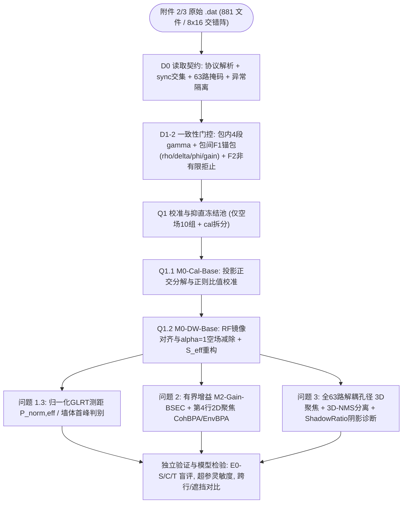

# A 题论文初稿（第一至第四章）

- **所属分支**：`paper/a-ch1-4-draft`（基于 `main` = `df24c4447e5eeea4dd3f571648adda4ab92cb9e4`）
- **结构与口径基准**：[PAPER_SCAFFOLD.md](PAPER_SCAFFOLD.md)、[NOTATION_TABLE.md](NOTATION_TABLE.md)、[RESULTS_AND_FIGURES_CHECKLIST.md](RESULTS_AND_FIGURES_CHECKLIST.md)、[data_contract.md](../../solutions/A/data_contract.md)（`D0-4`）、[fold_gate_contract.md](../../solutions/A/fold_gate_contract.md)（`D1-2`）及已合并模型方案 [model_q1.md](../../solutions/A/model_q1.md) / [model_q2.md](../../solutions/A/model_q2.md) / [model_q3.md](../../solutions/A/model_q3.md)。
- **数值合规声明**：本章仅引用**已合入主线的工程协议核查与合成/单组(`data1`)预检事实**（均标明边界）；**全部实测校准、抑制、测距、二维/三维成像实验结果及全量 110 组预处理汇总均保留为 `[待补]`**，待独立验收后于结果集成阶段填入。

---

## 一、问题重述

### 1.1 研究背景与探测体制
超宽带穿墙探地雷达通过向介质发射宽带高频电磁波并记录多通道回波的到达时延、幅度衰减及空间相干分布，非破坏性地反演墙后或墙内目标的几何位置与空间构型。与单发单收体制相比，单发多收（SIMO）二维平面阵列无需机械垂向扫描即可在同一时刻获取多角度散射响应，为高精度测距及多维聚焦成像提供了丰富的空间孔径信息[10]。

本题采用一套 64 阵元 Vivaldi 平面天线阵列（8 行 16 列交错均匀排布，阵列平面垂直地面，第 4 行第 8 列天线单独发射，其余 63 路天线同步接收）。发射链路选定**第二奈奎斯特区射频镜像体制**：数字域生成周期 $T_p = 1\,\mu\text{s}$（$N_p = 4000$ 点，采样率 $f_s = 4\text{ GHz}$）的 $0.3\text{–}1.7\text{ GHz}$ 加汉明窗实值线性调频（LFM）序列 $s[n]$，物理空间实际辐射的是与之关于半采样率 $f_s/2 = 2\text{ GHz}$ 镜像对称的 $3.7\text{–}2.3\text{ GHz}$ 下行扫频信号（$f_R = f_s - f_D$）。由于阵列在硬件链路长度、放大器增益与滤波器群延迟上存在通道差异，加之发收天线紧邻产生极强的端射直达波，如何在未提供发射端绝对触发同步零点与硬件全通道标定曲线的条件下，从连续采样回波中剥离系统失真与直达波干扰，并逐级完成一维测距、二维剖面重建及三维空间定位，构成全题的核心挑战。

### 1.2 实测数据规模与题面协议口径核实
针对附件数据，结合官方读取脚本 `get_data_iq.m` 与实盘文件逐字节解析，在保持竞赛原始附件只读不变的前提下，首先对齐题面文本表述与实测二进制存储之间的三项工程口径差异（不改动题面物理定义）：

1. **存储格式与解析协议**：题面正文示例以 `.txt` 与 `readmatrix` 示意，而附件 2、附件 3 实盘文件均为二进制 `.dat`（按 `get_data_iq.m` 小端 `int16` 交织数据包封装，`magic = 963072`）；全语料共计 **881 个 `.dat` 文件（801,111,612 B）**、**3129 个合法数据包**。
2. **包长与周期边界特性**：题面说明每列截取 3 个整周期共 12000 点，而实盘每个数据包每通道实际包含 **16000 点**（长度恰好等价于 $4$ 个 $N_p = 4000$ 发射周期）。然而“16000 点为 $4 N_p$”仅代表总采样时长为 $4\,\mu\text{s}$，由于收发异步启动，采集起点并未预先对齐到物理扫频边界，因而必须在预处理环节建立段间/包间一致性门控后再折迭至单周期，不能简单任取 12000 点视作边界已对齐。
3. **附件目录归属与数据完整性异常**：实盘中附件 1 为读取脚本 `get_data_iq.m`，附件 2 为测距数据（空场 10 组、墙体 20 组、金属板 20 组），附件 3 为成像数据（墙体 33 组、金属目标 28 个时间戳前缀）。经全量完整性体检，全语料共构成 **110 个完整 8 文件组**与 **1 个 0 字节孤儿文件**（`附件3/金属柱和金属铲/2026-11-12-22-50-31_16000_7.dat`，无同前缀其余 7 行），故金属目标有效测量组数恰为 **27 组**，与题面声明完全一致；另有 3 组存在行间采样包数差异（相差 1 包）及 1 个文件末包含 46 个孤立 `-32768` 样点，需在读取契约中显式隔离记录。

### 1.3 子问题任务拆解
在统一预处理与参数传递链路下，本文依次求解以下三个递进问题：
- **问题 1（数据处理与测距）**：利用空场与已划分的校准集（禁止任何检验组标签参与校准或调参），(1.1) 锚定固定参考通道并在扣除几何传播路径差后校正 63 路接收通道的相对时延、幅频增益与剩余相位差；(1.2) 依据空场信号抑制强端射直射波干扰，同时保持近距目标回波可读；(1.3) 在距离未知的检验组上反演墙体或金属板前表面至阵列平面的垂直距离，并在内插与外推区间上分别评价误差。
- **问题 2（墙体二维剖面成像）**：针对含前墙 A（厚 $10.5\text{ cm}$）与后墙 B（厚 $35\text{ cm}$）的 33 组步进扫查（步距 $5\text{ cm}$，$x_j = -20 + 5(j-1)\text{ cm}$）测量数据，(2.1) 设计随双程时延/等价距离变化的远距离增益补偿方案以平衡前墙衰减与扩散损耗；(2.2) 选用阵列单行阵元建立 $x \in [-20, 140]\text{ cm},\ y \in [0, 250]\text{ cm}$ 区域内的二维剖面聚焦模型，分析双墙表观位置与走向，并定量对比增益处理前后后墙的可辨识度变化。
- **问题 3（全阵列三维成像）**：融合全部 63 路二维交错接收孔径，(3.1) 对 33 组墙体数据在 $x \in [-20, 140],\ y \in [0, 250],\ z \in [20, 80]\text{ cm}$ 内重构双墙三维空间展布；(3.2) 对 27 组金属目标数据（$x_j = 5(j-1)\text{ cm}$）在 $x \in [0, 130],\ y \in [0, 250],\ z \in [20, 80]\text{ cm}$ 内分别定位金属柱与金属铲的三维坐标及空间范围，并定量刻画金属强反射体在其后方墙面形成的电磁遮挡阴影。

---

## 二、问题分析

### 2.1 问题一分析：混淆未知激励下的相对系统辨识与相干测距
问题 1 本质上包含两个耦合逆问题：多通道硬件频响的相对系统辨识（问题 1.1）与单基地-双基地广义几何相干匹配定位（问题 1.2–1.3）。
- **核心难点 1 — 不可识别自由度与第二奈奎斯特区射频混叠**：由于每组测量存在未知连续异步触发偏移 $t_0^{(g)} \in [0, T_p)$，且参考接收通道本身的硬件响应 $H_{i_{\text{ref}}}(f_D)$ 含未知一般色散（幅度滚降与非线性相位），观测数据在代数上对变换 $\big(H_i e^{-j2\pi f_R a},\, t_0^{(g)} + a\big)$ 完全不变。此外，相对传递函数 $H_i^{\text{rel}}(f_D)$ 内部的线性相位与时延参数 $\Delta\tau_i$ 共线。若按常规基带脉冲理解对离散序列直接作整数/分数数字移位 $e^{-j2\pi f_D\tau}$，会遗漏第二奈奎斯特区载波混叠项 $e^{+j2\pi f_s\tau}$，导致亚采样时延相干相消；同样，若仅依赖单一标量零点 $t_{0,\text{eff}}^{(g)}$ 对齐参考波形 $S(f_D)$，无法吸收未知公共色散 $H_{i_{\text{ref}}}(f_D)$。为此，模型必须在核带 $\mathcal{B}_{\text{core}}$ 加权线性投影正交规范下唯一定义 $(\Delta\hat{\tau}_i, \hat{G}_i, \hat{\psi}_i)$，并在测距阶段由对齐校准空场直接重构显式有效参考模板 $\hat{S}_{\text{eff}}^{(g)}(f_D)$ 以实现端到端色散对消（多通道失配及穿墙阵列校准机制可参考 [1, 2]）。
- **核心难点 2 — 周期信号域界定与几何加权偏置消除**：发射波形为占满整周期 $1\,\mu\text{s}$ 的周期性 LFM 脉冲，原始带限时间波形在全周期上交叠严重，直射波窗与晚时背景窗均不可在原始时域通过到达时间差强行隔绝，而必须统一转换至单位模板能量归一化的**循环距离压缩延迟域** $z_{\text{MF},i}(\tau)$（带跨零模 $T_p$ 卷绕）。在测距目标函数构造上，传统的未归一化延迟叠加（DAS）若在分子随试探距离乘以球面传播因子 $R_i^{\text{tgt}}(d)$ 而分母不归一化，会在目标真值处引入正一阶导数偏项 $\sum_i R_i'(d_0)/R_i(d_0) > 0$；本文改用满足 Cauchy-Schwarz 紧界的归一化广义似然比（GLRT）剖面 $P_{\text{norm,eff}}(d)$ 作为主统计量，并并行保留标量基准 $P_{\text{norm}}(d)$ 与非相干包络 $P_{\text{env}}(d)$ 用于实测假说验证（不预先断言优劣）。
- **替代方案对比**：在直射波抑制阶段，可选方案包括直接固定空场比例 $\alpha_g \equiv 1.0$ 减除（`M0-DW-Base`）与在窄窗内拟合自适应缩放因子 $\hat{\alpha}_g$ 或构建空场低秩子空间投影（`M0-DW-Subspace`）。鉴于有限带宽加窗主/旁瓣拖尾在近距目标（如 `42 cm` 墙体）仍会向直射波窗内产生微弱泄漏（先导合成反例测得压缩域 `-44.4 dB`，原始时域达 `1.16e-3`），经典基线首先严守固定 $\alpha_g \equiv 1.0$ 以确保零目标标签泄漏，将自适应比例与子空间抑制作为受控对照改进另行对比验证[3]。

### 2.2 问题二分析：远距离衰耗补偿权衡与单行合成孔径聚焦
问题 2 属于受限孔径下的逆散射聚焦与动态范围调控问题。
- **核心难点 1 — 增益提升与远场噪底抬升的互斥权衡**：电磁波在传播至 $y \approx 200\text{ cm}$ 后墙 B 的过程中，不仅承受双程自由空间几何扩散（能量比前墙 A 弱 $13\text{–}26\text{ dB}$ 量级），穿过 $10.5\text{ cm}$ 砖质前墙 A 时还要叠加双界面菲涅耳反射损失与介质衰减。备选增益策略中，滑窗瞬时自动增益控制（AGC）会抹平强散射界面与空白走廊的相对散射强度差异；无界指数时间增益（SEC）在高时延空白区会把残余噪声指数级放大至虚警水平（参见 [4]）。为此，本文选用兼顾物理依据与噪声稳健性的**有界双分量增益模型（`M2-Gain-BSEC`）**：在起步过渡区 $\tau \le \tau_0$ 保持增益恒为 $1$（防止放大直射波残余），在中间段联合幂次几何扩散补偿与指数衰减补偿，并在选定法向饱和深度 $\tau_{\text{sat}}$ 与硬幅值上限 $G_{\text{cap}}$ 处实施双层截断。
- **核心难点 2 — 倾斜前墙透射延迟与跨剖面波束效应**：依据题面图 5(b)，前墙 A 为斜置有限长度砖墙，而天线阵列固定面向 $+y$ 水平步进。在无前墙介质介电常数 $\varepsilon_r$ 先验标定时，按均匀自由空间波速 $c_0$ 对后墙 B 进行双向走时反演所得到的坐标属于**视在成像深度**：穿透 $\varepsilon_r > 1$、厚 $d_A = 10.5\text{ cm}$ 前墙的射线群速度降至 $c_0/\sqrt{\varepsilon_r}$，导致前墙后方的后墙影像沿 $+y$ 产生视在后移 $\Delta y_{\text{app}} \approx d_A(\sqrt{\varepsilon_r} - 1)$。另一方面，单行 Vivaldi 天线在垂直 $z$ 向具有较大波束宽度，非共面高度斜距 $y_{\text{app}} = \sqrt{y^2 + (\Delta z)^2}$ 会展宽二维图像中的墙体条带厚度；且中心射频 $f_c = 3.0\text{ GHz} > f_s/2$ 决定了插值必须在过采样复基带上执行后再解析恢复 $e^{-j2\pi f_s\tau}$。基于上述机理，选定与发射天线严格共面的第 4 行（$r=4$）作主重建平面，第 3/5 行作三维精确坐标对照校验，对比相干反向投影（`CohBPA`）与包络均值剖面（`EnvBPA`）的聚焦稳定性（参见 [5, 6]）。

### 2.3 问题三分析：非对称三维分辨率与强金属目标遮挡解析
问题 3 拓展至全 63 路阵列的三维协同重建，其数学本质是多站位合成水平孔径与固定有限垂向孔径共同约束的矢量空间反向投影。
- **分辨率的非对称物理边界**：虽然 $33$ 组/$27$ 组沿 $+x$ 的 $5\text{ cm}$ 步进形成了 $\ge 1.30\text{ m}$ 的宽水平合成孔径（中心射频处水平横向理论分辨率 $\Delta x_{\text{res}} = \lambda_c / (4\sin 45^\circ) \approx 3.54\text{ cm}$，距离向 $\Delta y_{\text{res}} = c_0/(2B) \approx 10.71\text{ cm}$），但阵列在垂直 $z$ 方向不发生机械平移，发射端恒定于 $z_4 = 0.545\text{ m}$，仅接收端拥有 $L_z = 0.490\text{ m}$ 有限物理高程孔径，从而决定垂向理论分辨率随距离线性退化（$\Delta z_{\text{res}}(y) \approx \lambda_c y / L_z$，在 $y=2.0\text{ m}$ 后墙处约展宽至 $41\text{ cm}$）。因此在成像孔径设计上，若简单采用统一窄锥角截断会丢失近场低高度角（如 $y=0.4\text{ m}, z=0.2\text{ m}$ 处金属铲底部）的照明；必须采用水平（$\pm 45^\circ$）与垂向（$\pm 55^\circ$）解耦的三维方向加权。
- **目标分离与遮挡阴影指标**：金属柱（竖直贯高）在固定单点发射下会呈现出由中心镜面主峰与上下端绕射边缘峰组成的连续垂向柱响应，若直接按小半径各向同性 3D-NMS 聚类会将单一立柱误拆为多个碎片目标；改用水平脚印柱域 3D-NMS 结合 $-10\text{ dB}$ 垂向跨度 $\Delta\hat{z}_{10\text{dB}}$ 与主峰高度特征可稳健区分高立柱与低矮金属铲，并以金属后方墙面相对无遮挡墙面的功率比（`ShadowRatio`）定量辨识屏蔽阴影区（参见 [7, 8]）。

### 2.4 整体建模框架与数据流图（`Fig 0-1`）
图 0-1 概括了全题“工程读取门控 → 相对校准与参考参数冻结 → 分支求解与检验闭环”的整体技术路线：各子问题共享同一套经过一致性门控折迭的基带频谱与已冻结硬件校准契约，杜绝验证集泄漏及跨阶段重复拟合。

> **图 0-1 图表合约注记（待导出版式图 SVG/PDF/600dpi TIFF）**：本图展示从原始 `.dat` 读取与一致性门控出发，经 Q1 相对校准与直射波模板参数冻结后向 1D 测距、2D 剖面成像与 3D 空间重构传递的数据闭环与检验路径（具体实测阈值标注 `[待各阶段验收定稿补齐]`）。

---

## 三、模型假设与符号说明

### 3.1 模型基本假设与合理性论证
本文仅提出服务于后续公式推导、物理可识别且可在检验环节复核的五条核心假设：

1. **假设 A1（第一轮真空光速统一与介质视在深度口径分离）**：在空气传播路径计算与自由空间等效成像基线中，统一采用真空光速 $c_0 = 299792458\text{ m/s}$；对于标准空气折射率 $n_{\text{air}} \approx 1.0003$ 的微小系统差异（对应 $1\text{ m}$ 目标仅约 $0.03\text{ cm}$ 偏移）在问题一灵敏度检验中单独量化，不在各子问题混用波速。对于问题二/三穿透 $10.5\text{ cm}$ 砖质前墙 A 的射线，基线明确以自由空间等效走时定义视在位置，待对比无墙照射段后壁深偏移 $\Delta y_{\text{app}}$ 再推算等效介质折射率诊断量 $\hat{\varepsilon}_r$。
2. **假设 A2（第二奈奎斯特区带限循环边界近似）**：实际数字参考 LFM 脉冲因有限时长 $T_p = 1\,\mu\text{s}$ 与汉明窗截断并非数学上严格带限信号，但经离散傅里叶谱计算确认，工作频带 $\mathcal{B} = [0.3, 1.7]\text{ GHz}$ 内的能量占比高达 `0.99991761`（`99.9918%`，仅约 $0.008\%$ 带外旁瓣泄露）。同时，全题目标最大双程传播时延均不超过 $25\text{ ns} \ll T_p = 1000\text{ ns}$。据此可将单周期信号在工作带 $\mathcal{B}$ 内视作周期 $T_p$ 循环平稳延拓，连续物理时延 $\tau$ 对应频域第二奈奎斯特区精确相移因子 $\exp(+j2\pi f_R\tau)$（$f_R = f_s - f_D$）。
3. **假设 A3（接收硬件相对传递函数跨组稳定性）**：在相同设备参数与同一实验批次下，各接收通道天线、线缆、放大器及滤波器引起的相对传递函数 $H_i^{\text{rel}}(f_D) = H_i(f_D)/H_{i_{\text{ref}}}(f_D)$ 保持跨测量组稳定，从而允许在问题一空场及校准池中估计并冻结逆校正算子后迁移至检验组与附件 3 成像组。该假设在实施中受空场 LOO 校准残差与各成像组压缩域直射窗抑制比 $\text{Supp}_{\text{dw-win}}^{(j)}$ 实时门控监测。
4. **假设 A4（多包异步偏移同阶平稳性与不主动补偿门控原则）**：发射端以 $N_p = 4000$ 点稳态循环播发，单包内 $16000$ 点在参考通道及有效接收中位数满足段间相干增益门限与包间相位一致性门限时，各接受包具有共同异步零点 $t_0^{(g)}$ 且可等权折叠；预处理阶段严格“只做淘汰拒止、不做未知载波移位修正”，将所有时间与色散补偿统一收口于后续频率校准与显式模板 $\hat{S}_{\text{eff}}^{(g)}$ 环节，防止预处理伪造相干性。
5. **假设 A5（端射直达波耦合基线与非偏置检验边界）**：在问题一经典基线（`M0-Cal-Base`）中，近似假定空场端射（$90^\circ$）直达波空间幅度响应满足自由空间几何衰减 $E_i^{\text{dir}}(f_D) \propto 1/R_i^{\text{dir}}$。针对端射近场天线互耦及增益差异可能引起的偏置，模型保留了基于近法向目标回波联合校准候选（`M0-Cal-Joint`）作后续对比检验，不预设该耦合误差为零。

### 3.2 统一符号说明表
下表汇总全篇跨 Q1–Q3 共用的核心数学与物理符号；全量扩展记号台账详见 [NOTATION_TABLE.md](NOTATION_TABLE.md)。为防止空间纵坐标与压缩响应及两类增益混淆，统一将阵列局部固定高程记为 $z_i^{\text{loc}}$、空间重构体素高程记为 $z$，循环压缩延迟响应记为 $z_{\text{MF},i}(\tau)$。

| 符号 | 数学与物理含义 | 单位 / 取值说明 |
|---|---|---|
| $c_0$ | 自由空间与第一轮统一计算光速 | $\text{m/s}$（$299792458$） |
| $f_s,\ T_s$ | 系统采样频率与采样间隔（$T_s = 1/f_s$） | $\text{Hz}\ (4.0\times 10^9),\ \text{s}\ (2.5\times 10^{-10})$ |
| $N_p,\ T_p$ | 单发射周期样点数与周期长度（$T_p = N_p T_s$） | $\text{点}\ (4000),\ \text{s}\ (1.0\times 10^{-6})$ |
| $\mathcal{B},\ \mathcal{B}_{\text{core}}$ | 数字工作频带 $[0.3, 1.7]\text{ GHz}$ 与相位投影核心子带 $[0.4, 1.6]\text{ GHz}$ | $\text{Hz}$（DFT 整数 bin $300\dots 1700$） |
| $f_D,\ f_R$ | 离散数字正频率与第二奈奎斯特区射频频率（$f_R = f_s - f_D$） | $\text{Hz}$ |
| $S(f_D),\ s[m]$ | 离散数字参考加窗 LFM 序列及其在 $\mathcal{B}$ 内复频谱 | $\text{LSB}$（$A = 30000$） |
| $i,\ \mathcal{I}_{\text{rx}}$ | 展平通道编号 $i = 8n + (k-1)\in\{0\dots 63\}$ 与有效接收集（剔除 $i_{\text{tx}}=27$） | 无量纲（$|\mathcal{I}_{\text{rx}}| = 63$，$i_{\text{ref}}=28$） |
| $\mathbf{p}_i^{\text{loc}},\ \mathbf{p}_{j,i}$ | 阵元局部坐标 $(x_i^{\text{loc}}, 0, z_i^{\text{loc}})$ 及第 $j$ 站位全局坐标 $(x_j+x_i^{\text{loc}}, 0, z_i^{\text{loc}})$ | $\text{m}$（地面 $z=0$，扫查面 $y=0$） |
| $x_j,\ J$ | 移动扫查测点序号 $j\in\{1\dots J\}$ 下发射天线的 $x$ 向坐标 | $\text{m}$（Q2/Q3.1 $J=33$；Q3.2 $J=27$） |
| $X_i^{(g)}(f_D)$ | 第 $g$ 组经 `D1-2` 一致性门控折迭后的带内复频谱 | $\text{LSB}$ |
| $t_0^{(g)},\ \Delta t_0^{(g)}$ | 组 $g$ 未知连续异步偏移及相对基准空场的射频对齐偏移量 | $\text{s}$ |
| $H_i^{\text{rel}}(f_D)$ | 第 $i$ 路相对固定参考通道 $i_{\text{ref}}=28$ 的复传递函数比 | 无量纲 |
| $\Delta\tau_i,\ G_i(f_D),\ \psi_i(f_D)$ | 加权线性投影规范下第 $i$ 路相对时延差、幅频比与剩余相位差 | $\text{s}$, 无量纲, $\text{rad}$ |
| $\lambda_{\text{cal}},\ \lambda_{\text{inv}}$ | 空场比值校准与逆滤波正则化无量纲功率比参数 | 无量纲（默认 $10^{-3}$） |
| $R_i^{\text{dir}},\ \tau_i^{\text{dir}}$ | 发射端直达接收端 $i$ 之直线路径与自由空间直射传播时延 | $\text{m},\ \text{s}$ |
| $\hat{S}_{\text{eff}}^{(g)}(f_D)$ | 吸收参考通道未知色散与异步偏移 $t_0^{(g)}$ 的显式有效模板 | $\text{LSB}\cdot\text{m}$ |
| $X_i^{(g,\text{cal})},\ \tilde{X}_i^{(g)}$ | 通道逆校正后频谱及固定 $\alpha_g \equiv 1$ 直射波减除后残余频谱 | $\text{LSB}$ |
| $d_g,\ R_i^{\text{tgt}}(d),\ \tau_i^{\text{tgt}}(d)$ | 问题一平面目标法向距离及镜像双程几何路径与传播时延 | $\text{m}\ (\text{兼列 }\text{cm}),\ \text{m},\ \text{s}$ |
| $z_{\text{MF},i}(\tau)$ | 单位模板能量归一化的循环距离压缩（匹配滤波）延迟响应 | 归一化幅值（周期 $T_p$） |
| $\mathcal{W}_{\text{dw},i},\ \mathcal{W}_{\text{bg}}$ | 跨零模 $T_p$ 卷绕直射窗（$\pm 1.0\text{ ns}$）与压缩域晚延迟背景代理（$[50,950]\text{ ns}$） | $\text{ns}$ |
| $P_{\text{norm,eff}}(d),\ P_{\text{norm}}(d),\ P_{\text{env}}(d)$ | 显式色散匹配、标量时延匹配与包络归一化测距统计量 | 归一化功率单位 |
| $W_{\text{comp}}(\tau),\ G_{\text{cap}}$ | Q2/Q3 两步硬封顶远距离回波增益函数及其最大幅值上限 | 无量纲（$G_{\text{cap}}=20.0$） |
| $\beta,\ \alpha_{\text{gain}},\ \tilde{\alpha}_y$ | 几何扩散补偿幂指数、时延衰减补偿率与折算深度指数系数 | 无量纲，$\text{ns}^{-1}$，$\text{m}^{-1}$ |
| $I_{\text{2D}}^{\text{coh}},\ I_{\text{2D}}^{\text{env}}$ | 问题二二维剖面相干聚焦能量分布与非相干包络对照分布 | 归一化聚焦能量 |
| $I_{\text{3D}}^{\text{coh}},\ I_{\text{3D}}^{\text{env}}$ | 问题三全 63 路三维空间聚焦能量分布与非相干包络对照分布 | 归一化聚焦能量 |
| $\text{ShadowRatio}_m$ | 金属目标 $m$ 正后方墙面区域相对无遮挡墙面能量的功率衰减比 | $\text{dB}$ |

---

## 四、数据读取与周期一致性预处理

### 4.1 二进制协议解析、组结构对齐与异常处理契约（`D0` 基线）
为保证全题所有子问题采用同一套严格可溯源输入并避免采样溢出错误，依据官方 `get_data_iq.m` 实现并独立验收了原始数据读取器（契约版本 `D0-4`，对应模块 `a_dat_reader.py`）：

1. **包解析与通道索引精确映射**：每个测量组由后缀为 `_0.dat` 至 `_7.dat` 的 8 个文件构成（行号 $n\in\{0\dots 7\}$ 对应阵列物理第 $r = n+1$ 行）。程序按小端 `uint32` 搜索包头标记 `magic = 963072`，校验 `total_len = 256020`、`type = 102`、`num = 16000`、`len = 16`（`freq` 字段实测全为 `0.0` 原样保留不参与运算），并将交织的 `8 * 16000` 个 `int16` 样本重排为 `(8, 16000)` 矩阵（第 $k$ 行对应行内第 $k$ 副天线）。全阵列展平索引定义为 $i = 8n + c \in \{0\dots 63\}$（$c=k-1$），局部三维坐标按题面图 1 与交错规则精确赋予：
   $$c_{\text{grid}}(r,k) = \begin{cases} 2k - 1, & r \text{ 为奇数}, \\ 2k, & r \text{ 为偶数}, \end{cases} \qquad x_i^{\text{loc}} = \big(8 - c_{\text{grid}}(r,k)\big)\cdot 0.035\text{ m}, \qquad z_i^{\text{loc}} = \big(75.5 - 7(r - 1)\big)\times 10^{-2}\text{ m}.$$
   设定发射通道掩码 `rx_mask[27] = False` 跳过不接收数据的发射通路（实测 RMS 仅约 `25`，约占最强接收通道 `9700` 的 `0.26%`），锁定有效接收通道 `63` 路及固定全局参考通道 `ref_idx = 28`（第 4 行第 5 列，与发射天线同处第 4 行且水平相距 $R_{28}^{\text{dir}} = 0.070000\text{ m}$）。
2. **共同 `sync` 交集配对与整型安全升位**：对组内 8 个文件严格依据包头递增序列号 `sync_packet_cnt` 取交集配对，输出 `(P, 64, 16000)` 原值张量与完整审计字典 `meta`。由于全语料中存在极值 `-32768`，凡涉及绝对值、比对或极值计数均强制先升位至 `int32` 再处理，防止 `int16` 取反回绕。
3. **全语料协议体检与隔离记录（仅数据完整性，不涉及建模估计）**：对附件 2、附件 3 全量 `.dat` 执行只读读取核查后，表 4-1 汇总各类别规模与异常隔离口径。需要强调：**`D0` 对缺包、孤儿文件及极值样点均采用原样留痕与严格交集截取，严禁静默插补或伪造样本。**

| 数据集类别（实盘路径） | 理论前缀数 | 完整 8/8 有效组数 | 文件数 | 包数不一致 / 异常处置说明（实测记录） |
|---|---|---|---|---|
| `附件2-测距数据/空场数据` | 10 | 10 | 80 | 8/8 行齐全，包数完全一致，无空/坏文件 |
| `附件2-测距数据/墙体数据` | 20 | 20 | 160 | 仅 `data10-82cm` 存在行间包数差异（`2,3`），按共同 `sync` 交集对齐 `P=2` |
| `附件2-测距数据/金属板数据` | 20 | 20 | 160 | 8/8 行齐全，包数完全一致（全 50 组测距文件经 `SPLIT0` 400/400 核对通过） |
| `附件3-成像数据/墙体` | 33 | 33 | 264 | 仅第 3 组 `2026-11-12-21-30-33_16000` 包数 `3,4` 不齐，取交集 `P=3` |
| `附件3-成像数据/金属柱和金属铲` | 28 | **27** | 217 | `22-50-31_16000_7.dat` 为 **0 字节孤儿文件**，保留台账后不计入第 28 组；第 8 组 `22-09-58_16000` 包数 `3,4` 不齐，且 `_1.dat` 末包（`sync=250`）含 **46 个孤立 `-32768` 样点**，交由 `D1` 门控核查隔离 |
| **合计** | **111** | **110** | **881** | 总包数 3129 全解析成功；400,512,000 个采样中 `+32767` 为 0 个、`-32768` 仅 46 个 |

*(表 4-1：A 题实盘原始数据读取器全量审计与异常隔离汇总；来源 `D0-4` / `RECON-0.1`，仅证明二进制格式及组完整性，不代表信号预处理或求解通过。)*

### 4.2 四段周期折迭与双层一致性门控（`D1-2` 基线）
由于原始每包包含 $16000 = 4 N_p$ 点，直接全包平均会受包内时钟微弱漂移或异常采样污染，而擅自做包间相位旋转又可能破坏跨通道硬件相位基准。因此预处理模块（契约版本 `D1-2`，对应 `a_fold_gate.py`）确立了**“只做检验拒止与等权折叠、不做主动相位/时延补偿”**的双层门控规则：

1. **第一层 — 包内 4 段相干增益门控**：对第 $p$ 个共同包按 $N_p = 4000$ 均匀切分为 $Q=4$ 段 $x[p,i,q,m] = \text{packets}[p,i,q N_p + m]$（$q\in\{0..3\}$），对每段在整数 DFT 频点 $k \in [300, 1700]$（严格按整数比定界，共 1401 点对应 $\mathcal{B} = [0.3, 1.7]\text{ GHz}$）求单边解析频谱 $S[p,i,q,k]$，定义合并谱 $A[p,i,k] = \sum_{q=0}^{3} S[p,i,q,k]$ 及**包内 4 段相干增益**：
   $$\gamma[p, i] = \frac{\sum_{k=300}^{1700} |A[p,i,k]|^2}{4 \sum_{q=0}^{3}\sum_{k=300}^{1700} |S[p,i,q,k]|^2} \in [0, 1].$$
   当段间仅存在均方根 $\sigma_\phi$ 的微小相位散布时，二阶展开给出 $\gamma \approx 1 - \sigma_\phi^2$；故设定参考通道门限 `gamma_ref_min = 0.99`（等价于段间相位散布 $\le 0.1\text{ rad}$，相干幅度损失 $\le 0.5\%$），全阵有效通道中位数门限 `gamma_median_min = 0.95`（容忍远排弱信噪比通道，仅拦截整阵失相）。同时施加 **`D1-2/F2` 全通道非有限值防护**：同一包内 64 路任一通道出现 `NaN`/`Inf`，立即整包拒止并登记原因码 `packet_nonfinite_samples`（若参考通道非有限则优先记 `reference_channel_nonfinite`）。

2. **第二层 — 包间参考通道复相干与极性一致锚包选择（`D1-2/F1`）**：在通过包内门控的候选包集合内，以参考通道 `ref_idx = 28` 为基准计算候选包 $p$ 与锚包 $a$ 的带内互谱 $C_p[k] = A_p[k] A_a^*[k]$ 及四项包间一致性统计量：
   $$\rho_p = \frac{\left|\sum_k C_p[k]\right|}{\sqrt{\sum_k |A_p[k]|^2 \sum_k |A_a[k]|^2}}, \qquad w_k = |C_p[k]|,$$
   加权线性拟合解卷绕相位得包间群时延漂移 $\delta_p = -\text{slope}/(2\pi)$，进一步扣除线性时延斜率后求常相位 $\phi_p = \arg\!\big(\sum_k C_p[k] e^{+j2\pi f_k \delta_p}\big)$ 与 RMS 增益跳变 $\text{gain\_db}_p = 20\log_{10}(\text{rms}_{\text{ref}}[p]/\text{rms}_{\text{ref}}[a])$。
   - **锚包选择规则（`F1`）**：为消除单一 $\rho$ 指标无法区分载波极性翻转（$\rho=1$ 但 $|\phi|=\pi$）从而受包排列顺序影响的问题，锚包评分按 `(n_ok(c), median_rho(c), -index(c))` 字典序选取最大者，其中 `n_ok(c)` 为以候选 $c$ 作锚时同时满足下表全部四项包间门限的同伴数。
   - **等权输出与全有限不变量**：通过两层门控的包集合记为 $\mathcal{P}_{\text{acc}}$，对原始实序列等权双层平均输出 `signals_folded` 形状 `(64, 4000)` `float64`（若全组拒绝则抛出 `FoldGateError` 并记录完整拒因日志，输出前校验全部元素有限性）。

| 门控参数 | 默认阈值 | 物理与工程依据 | 空场 `data1` 实测区间 |
|---|---|---|---|
| `gamma_ref_min` | $\ge 0.99$ | 等价段间相位散布 $\sigma_\phi \le 0.1\text{ rad}$，相干幅损 $\le 0.5\%$ | `0.999876 ~ 0.999983` |
| `gamma_median_rx_min` | $\ge 0.95$ | 屏蔽孤立远排低 SNR 通道误判，仅拦整阵不同相（$\sigma_\phi \le 0.22\text{ rad}$） | `0.999024 ~ 0.999733` |
| `rho_min` | $\ge 0.99$ | 矩形带限下 $\|\operatorname{sinc}(\pi B \delta)\| \ge 0.99 \Leftrightarrow \delta \lesssim 55\text{ ps}$ | `0.999979 ~ 0.999996` |
| `delta_max_ps` | $\le 50\text{ ps}$ | 等价距离涂抹 $c_0\delta/2 = 0.75\text{ cm} \ll 3.75\text{ cm}$ 步长（$0.2\,T_s$） | $\|\delta\| \le 2.3\text{ ps}$（实测最大值 `-2.271 ps`） |
| `phase_max_rad` | $\le 0.1\text{ rad}$ | $\cos(0.1)=0.995$，且大余量拦截 $\|\phi\|=\pi$ 极性/载波翻转 | $\|\phi\| \le 0.026\text{ rad}$（实测最大值 `-0.02539 rad`） |
| `gain_max_db` | $\le 3.0\text{ dB}$ | 防止单包异常幅度跳变主导等权均值 | $\|\text{gain}\| \le 0.005\text{ dB}$（实测最大值 `-0.0041 dB`） |

*(表 4-2：`D1-2` 预处理默认门控阈值、物理依据与空场 `data1` 实测余量；全量其余 109 组门控表现 `[待补]`。)*

3. **单组预检结果（仅限空场 `data1`）与全量预处理统计待补槽位**：
   在已获验收的 `D1-2` 基准下（作者测试 91/91、独立验收 69/69、历史回归 70/70 通过，仅涵盖合成算例与空场 `data1` 单组实测诊断），空场 `data1` 共有 4 个共同包（`sync = 114, 115, 116, 117`），锚包选定 `index=1`（`sync=115`），4/4 包全部通过门控；折叠后 63 路有效接收通道 RMS 中位数为 `1950.7`（范围 `302.5 ~ 10979.4`，参考通道 `28` 为 `9700.9`，未接收的发射通道 `27` 仅 `13.7`）。
   - **方法边界声明**：(a) 若出现 1 对 1 等规模极性冲突（无多数簇可依），`D1-2` 按包序号择小保留并记录为需人工复核情形，不伪造多数；(b) 包间门控以 `ref_idx=28` 为单点判据（范围限定 `F3`），不单独保证其余 62 路行板之间不存在微弱跨板异步抖动（需由后续行板检验及 Q1 校准残差进一步核查）。
   - **全量预处理结果汇总（`[待补]`）**：空场 10 组、墙体/金属板校准及检验 40 组、以及附件 3 成像 60 组（含第 8 组末包 46 个 `-32768` 样点门控日志）在 `D1-2` 下的逐组包接受率、`gamma`/`rho`/`delta`/`phi` 汇总统计与异常拒绝清单，统一列为 **`[待补：待 E0 与后续批复执行分支全量实测通过后回填]`**，此处严禁提前外推。
